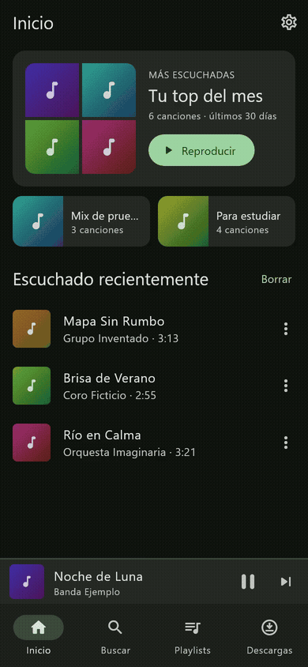

# Koda 🎵 - Flutter Audio Architecture PoC

> **⚠️ Disclaimer Legal:** Este proyecto ha sido creado con fines estrictamente educativos y como una prueba de concepto (Proof of Concept) de arquitectura de software avanzada en Flutter. No está diseñado para su distribución comercial, no fomenta la piratería y utiliza APIs públicas y librerías de terceros (como `youtube_explode_dart`) únicamente como fuente de datos masiva para probar el estrés y la viabilidad de la arquitectura. **No se proveen binarios compilados (APK/AAB).**

Koda es una aplicación de reproducción de audio híbrida (Streaming + Offline) construida para demostrar la implementación de **Clean Architecture**, **gestión de estado reactiva** y **manejo complejo de audio en segundo plano** en Flutter.

## 🚀 Sobre el Proyecto

El objetivo principal de este proyecto es resolver problemas arquitectónicos comunes en aplicaciones multimedia complejas, tales como:
- Mantener sincronizada la interfaz de usuario con un motor de audio en segundo plano.
- Gestionar una fuente de verdad única entre una base de datos local (SQLite) y un estado reactivo (Riverpod).
- Interceptar y resolver dinámicamente el origen de un archivo multimedia (decidir en milisegundos si reproducir desde caché local o pedir una URL temporal por streaming).

## 🛠️ Stack Tecnológico

- **Framework:** Flutter / Dart
- **Gestión de Estado:** Riverpod (`flutter_riverpod`)
- **Arquitectura:** Clean Architecture estructurada por funcionalidades (*Feature-first*)
- **Base de Datos:** SQLite (`sqflite`)
- **Motor de Audio:** `just_audio` + `audio_service` (OS Media Controls)
- **Fuente de streaming:** `youtube_explode_dart` (resolución de URLs de audio)
- **Networking & Descargas:** `dio` (Chunked downloads)
- **Plataformas:** Android e iOS (audio en segundo plano)

## 🏗️ Arquitectura y Diseño

El proyecto sigue un enfoque **Feature-first** con separación de capas internas para garantizar la escalabilidad y la testabilidad:

```text
lib/
├── core/             # Base de datos, clientes HTTP, utilidades y modelos de dominio compartidos.
├── features/         # Módulos independientes (Home, Player, Playlists, Downloads, Search).
│   └── [feature]/
│       ├── domain/   # Entidades puras y Casos de Uso.
│       ├── data/     # Repositorios, DAOs y Data Sources (APIs).
│       └── presentation/ # Widgets tontos y Notifiers (Riverpod).
└── shared/           #
```

## ✨ Retos Técnicos Resueltos

- **Resolución de Reproducción Híbrida (PlaybackSourceResolver):** Un patrón interceptor que evalúa dinámicamente cada canción antes de reproducirse. Si el archivo existe en el almacenamiento local, inyecta un `LocalFileSource`. Si no, negocia una nueva URL de streaming (evitando problemas de caducidad de tokens).
- **Gestor de Descargas Concurrente:** Implementación de un `DownloadManager` personalizado usando `dio` para descargar archivos grandes en fragmentos (chunks), permitiendo pausar, cancelar y reanudar descargas en caso de fallo de red.
- **Audio Background & OS Integration:** Integración profunda con Android/iOS para mantener la reproducción con la pantalla apagada, respondiendo a eventos de auriculares Bluetooth y controles en la pantalla de bloqueo a través de `audio_service`.
- **Motor de Recomendaciones Local:** Un algoritmo híbrido que cruza los grafos de canciones recomendadas de una API pública con el historial de reproducción local (SQLite) para sugerir la siguiente pista automáticamente (Radio Infinita).
- **Reanudar la última reproducción:** Al cambiar de pista, pausar o mientras suena (cada 5 s), se guardan la cola, el índice y la posición en la tabla `settings`. Al abrir la app, la última canción se carga en pausa en ese punto, omitiendo las que ya no existen.
- **Fin de pista por posición:** El avance a la siguiente pista no depende solo del evento `completed` del reproductor: se detecta también cuando la posición llega al final de la duración guardada en la base de datos.

## ⚠️ Problemas conocidos

- **Duración del stream distinta a la metadata:** para algunos videos, el audio que resuelve YouTube dura más que la canción guardada. La app usa la duración guardada como referencia para la barra de progreso y el fin de pista.

## 📱 Demo



La demo usa canciones y carátulas ficticias, generadas por un test (`test/demo`).

## ⚙️ Cómo ejecutar el proyecto (Modo Desarrollo)

1. **Clona el repositorio:**
```bash
git clone https://github.com/MiguelEscSan/PlayMusic.git
```
2. **Instala las dependencias:**
```bash
flutter pub get
```
3. **Ejecuta la aplicación:**
```bash
flutter run
```

